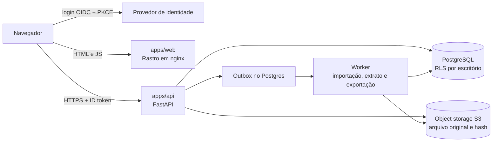
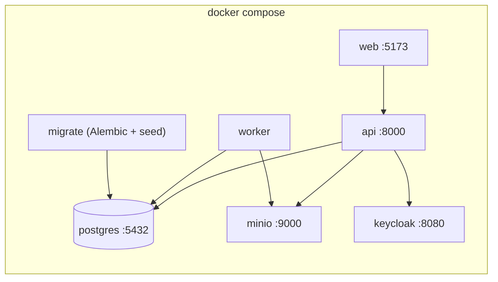
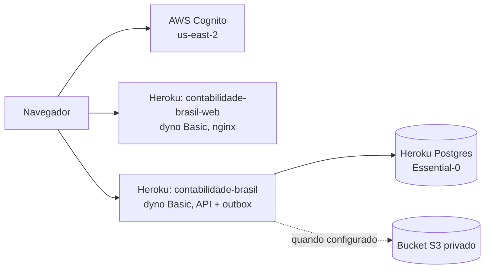

# contabilidade_brasil

Base de produto, domínio e código para uma plataforma contábil de escritórios no Brasil. A interface se chama **Rastro**: fechamento com evidência.

O repositório tem duas partes. A primeira é a fundação de produto: benchmark, modelo de domínio, specs, ADRs e contratos JSON. A segunda é uma aplicação que já roda: razão de partidas dobradas, períodos, fechamento, importação, conciliação bancária, documentos, pedidos de documento, exportação da competência, portal do cliente e auditoria, com uma interface web e um piloto hospedado.

Ainda não é um produto fiscal pronto. Não há regra tributária, obrigação acessória, transmissão a órgão nem plano referencial suficiente para produção.

## Tese

O produto deve competir por **confiança operacional mensurável**:

- cada saldo é explicado até a origem;
- cada obrigação tem versão, status, protocolo e responsável;
- cada migração é reconciliável;
- cada cliente consegue sair com os seus dados em formato útil.

O primeiro público é um escritório com cerca de **20 a 200 CNPJs**, em dois ou três estados, com um conjunto fiscal controlado. O produto entra ao lado do sistema legado e não exige troca completa no primeiro dia.

## O que o sistema faz hoje

| Área | O que funciona | Onde fica na sala |
| --- | --- | --- |
| Escritório e acesso | Login OIDC, escritório (tenant) isolado no banco por RLS, papéis `preparer`, `approver`, `admin`, `viewer` e `client`. O cliente fica numa empresa só. | Barra lateral do escritório, ou a casca do cliente |
| Empresas | O admin cadastra a empresa com CNPJ validado e único no escritório. Ela nasce com matriz, modelo mínimo de contas e 12 períodos abertos. | Rotinas do razão › Nova empresa |
| Plano de contas | Contas sintéticas e analíticas por empresa. Só conta analítica (postável) recebe lançamento. | Rotinas do razão › Plano de contas |
| Lançamentos | Rascunho equilibrado, envio, aprovação e publicação. Quem cria não aprova nem publica. Publicado não se edita: corrige-se por estorno vinculado. | Hoje, Dados e ledger, Rotinas do razão › Novo lançamento |
| Balancete | Débito, crédito e saldo por conta e competência, com drill-down até a linha. | Rotinas do razão › Balancete |
| Períodos | O checklist bloqueia o fechamento. O snapshot fica gravado com SHA-256. Reabrir pede motivo e aprovação de outra pessoa e não altera o snapshot. | Fechamentos |
| Pendências | Pedido de documento na competência. Aberto ou recebido bloqueia o fechamento. Hoje mostra a fila do escritório. | Hoje e Pendências |
| Importação | Lote CSV em simulação, relatório de diferenças e publicação por outra pessoa. Identificador já importado não entra de novo. | Migrações |
| Bancos e conciliação | Conta bancária ligada ao plano, extrato CSV ou OFX, casos Sugerido e Sem candidato, aprovação humana do vínculo. | Conciliação; Rotinas do razão › Bancos |
| Documentos | Arquivo original no object storage com hash SHA-256, tipo e competência. | Evidências |
| Exportação | JSON da competência com lançamentos, documentos, pedidos, auditoria, totais do balancete e SHA-256. | Evidências |
| Portal do cliente | O cliente envia o arquivo do próprio pedido, vê o resumo, o histórico, a conversa e pode mandar um documento sem pedido. Não vê o razão e não confirma. | Casca do cliente |
| Auditoria | Eventos encadeados por hash, com verificação da cadeia. | Rotinas do razão › Auditoria |

Revisões de IA, obrigações e entregas e integrações externas aparecem no menu, mas a tela diz que ainda não há contrato. Elas não simulam estado.

## Como usar

### Papéis

| Papel | Pode |
| --- | --- |
| `preparer` | Criar conta e rascunho, enviar para aprovação, montar lote de importação, enviar documento e extrato, pedir reabertura, pedir documento e pedir a exportação da competência. |
| `approver` | Aprovar, rejeitar e publicar o lançamento de outra pessoa; publicar lote; aprovar conciliação; fechar período e aprovar a reabertura pedida por outra pessoa; confirmar o pedido de documento. |
| `admin` | O que os dois acima podem, mais cadastrar empresa, convidar pessoas para o escritório e convidar o cliente de uma empresa. |
| `viewer` | Consultar, inclusive a fila de pendências e a exportação já gerada. Não dispara exportação. |
| `client` | Ver o resumo, o histórico e a conversa da própria empresa, enviar arquivo e um documento sem pedido, e escolher o aviso por e-mail. Não confirma, não cancela e não abre a sala do escritório. |

A segregação vale mesmo para quem tem vários papéis: quem criou o lançamento não aprova nem publica esse lançamento.

O primeiro admin nasce no comando `contabil.bootstrap`. Os seguintes entram em **Administração**: o admin informa usuário, nome, e-mail e papéis. Para o cliente, o papel Cliente vem sozinho e a empresa é obrigatória ([ADR 025](docs/adr/025-portal-do-cliente.md)). O Cognito manda a senha temporária por e-mail, e a pessoa troca essa senha no primeiro acesso. A tela não mostra a senha ([ADR 019](docs/adr/019-convite-de-usuario.md)).

### Um ciclo de trabalho

1. Entre pela tela do Rastro. O login vai ao provedor de identidade e volta para `/app/rastro`.
2. Na barra **Cliente / CNPJ**, no topo, escolha a empresa. A competência ao lado é dessa empresa.
3. Em **Hoje**, veja o que bloqueia o fechamento e os lançamentos recentes. Abrir uma pendência troca a empresa e a competência da barra.
4. Em **Pendências**, peça o documento, envie o arquivo ou confirme. A fila do escritório lista as outras empresas.
5. Em **Rotinas do razão › Novo lançamento**, monte um rascunho equilibrado e envie para aprovação.
6. Outra pessoa, com papel `approver`, abre o lançamento, aprova e publica.
7. Confira o saldo em **Rotinas do razão › Balancete** e desça até a linha.
8. Em **Conciliação**, envie o extrato e decida cada caso sugerido.
9. Em **Evidências**, gere a exportação da competência e confira o SHA-256 quando o estado estiver pronto.
10. Em **Fechamentos**, abra o checklist, revise o balancete e feche a competência. Baixe o pacote e confira o SHA-256.

O cliente entra com o próprio usuário e vê só os pedidos da empresa. Enviar o arquivo não confirma o pedido: quem confirma é o escritório.

A caminhada sintética da empresa fictícia Orbe fica em **Demonstração**, no grupo Sistema. Ela mostra o desenho futuro da sala e não grava lançamento.

## Arquitetura

Monólito modular para o domínio e um serviço separado só para a interface ([ADR 003](docs/adr/003-monolito-modular.md), [ADR 016](docs/adr/016-frontend-separado.md)). A ideia é provar ledger, migração, conciliação e fechamento sem espalhar invariantes contábeis por vários serviços.



### Serviços

| Serviço | Pasta | Responsabilidade |
| --- | --- | --- |
| Interface | `apps/web` | React e Vite, servido por nginx sem root. Uma casca só, a sala Rastro ([ADR 018](docs/adr/018-uma-casca-visual.md)). Não acessa banco, não guarda segredo e não decide regra de tenant. |
| Domínio | `apps/api` | FastAPI, SQLAlchemy e Alembic. É o único serviço que toca banco, object storage e outbox. |

### Módulos do domínio

| Módulo | Pasta em `apps/api/src/contabil/` | Conteúdo |
| --- | --- | --- |
| Tenancy | `tenancy/` | Escritório, membership, empresa, cadastro com CNPJ, convite e `/v1/me`. |
| Identidade | `identity/` | Diretório de usuários: convite no Cognito, com a senha temporária por e-mail. |
| Master data | `master_data/` | Plano de contas, centro de custo e o modelo mínimo de contas. |
| Ledger | `ledger/` | Journals, linhas, aprovação, publicação, estorno e balancete. |
| Períodos | `periods/` | Abertura, fechamento e reabertura aprovada. |
| Fechamento | `closing/` | Checklist, snapshot imutável e pacote gerado no download. |
| Importação | `imports/` | Lotes CSV, simulação, relatório de diferenças e publicação. |
| Conciliação | `reconciliation/` | Contas bancárias, parser de CSV e OFX, matching explicável e casos. |
| Documentos | `documents/` | Upload, hash e download do arquivo original. |
| Pedidos de documento | `document_requests/` | Pedido na competência, envio, confirmação, cancelamento e a fila do escritório. |
| Exportação | `exports/` | Pacote JSON da competência, gerado pelo outbox, com SHA-256 e auditoria. |
| Portal do cliente | `portal/` | Rotas do cliente: os pedidos da própria empresa e o envio do arquivo. |
| Auditoria | `audit/` | Eventos encadeados por hash e verificação. |
| Plataforma | `platform/` | Autenticação, escopo do cliente (`require_office`), RLS, idempotência, correlation ID, outbox, storage, dinheiro em decimal. |

### Garantias no código

- **Partidas dobradas:** publicação exige débitos iguais a créditos; dinheiro é `Decimal`, nunca float.
- **Imutabilidade:** journal publicado não muda; trigger no banco reforça a regra ([ADR 001](docs/adr/001-ledger-immutavel.md), [ADR 010](docs/adr/010-rls-e-triggers.md)).
- **Isolamento:** toda tabela de negócio tem `tenant_id` e RLS forçada, inclusive para o dono da tabela ([ADR 005](docs/adr/005-isolamento-de-tenant.md)). O cliente fica preso à empresa da membership: as rotas do escritório respondem 403 para ele, e o banco exige empresa em toda membership `client` ([ADR 025](docs/adr/025-portal-do-cliente.md)).
- **Aprovação humana:** nenhum efeito contábil sai sem uma segunda pessoa autorizada ([ADR 004](docs/adr/004-aprovacao-humana.md)).
- **Idempotência:** POSTs que mudam estado aceitam `Idempotency-Key`; o mesmo pedido devolve a mesma resposta ([ADR 006](docs/adr/006-adaptadores-e-idempotencia.md)).
- **Jobs:** importação, extrato e exportação vão para o outbox, com retry limitado e dead-letter. A resposta traz `operation_id` e `correlation_id`, e `GET /v1/operations` lista as operações ([ADR 008](docs/adr/008-outbox-postgresql.md), [ADR 012](docs/adr/012-jobs-outbox.md), [ADR 023](docs/adr/023-exportacao-operacional.md)).
- **Evidência:** o arquivo original fica no object storage com hash; o banco guarda metadado e referência ([ADR 011](docs/adr/011-object-storage-s3.md)).

O desenho completo, inclusive módulos ainda não construídos, está em [docs/architecture.md](docs/architecture.md) e no [modelo de domínio](docs/domain-model.md).

## Deploy

### Local



O compose sobe tudo, inclusive um Keycloak de desenvolvimento e um MinIO ([ADR 009](docs/adr/009-oidc-keycloak-dev.md)). O `migrate` aplica as migrações e carrega o seed sintético antes da API subir.

### Piloto hospedado



| Peça | Escolha | Observação |
| --- | --- | --- |
| Interface | App Heroku `contabilidade-brasil-web` | Publicado com `git subtree push --prefix apps/web heroku-web main`. |
| API | App Heroku `contabilidade-brasil` | Publicado com `git push heroku main`. O release roda as migrações. O outbox roda no mesmo processo. |
| Banco | Heroku Postgres Essential-0 | RLS forçada; o seed de demonstração não roda aqui. |
| Login | AWS Cognito, client público com PKCE | MFA opcional por aplicativo; o escritório vem do atributo `custom:tenant_id`. |
| Arquivos | Bucket S3 privado em `us-east-2` | Versionado e sem acesso público. A API grava e lê só nesse bucket. Sem ele, documentos, importação, extrato e o envio do cliente ficam indisponíveis. |

O piloto custa cerca de US$ 19 por mês e guarda o dado nos Estados Unidos. Por isso só aceita dado fictício ([ADR 015](docs/adr/015-piloto-barato-heroku.md)). A ida para AWS São Paulo está descrita no [ADR 014](docs/adr/014-deploy-piloto-aws-sa-east-1.md), para quando o escritório depender do sistema no dia a dia.

O roteiro completo do piloto está em [deploy/pilot/README.md](deploy/pilot/README.md): apps, Cognito, configuração, bootstrap do escritório, usuário de teste, primeira empresa, o comando das empresas de teste nos escritórios piloto e Litoral e o login dos clientes de teste.

## Estrutura

| Caminho | Finalidade |
| --- | --- |
| `apps/api/` | Serviço de domínio: API, módulos, migrações Alembic, testes unitários e de integração. |
| `apps/web/` | Serviço de interface: sala Rastro, rotinas e smoke E2E com Playwright. |
| `deploy/` | Imagens locais (Postgres, Keycloak) e o roteiro do piloto. |
| `docs/specs/` | Cinco anchors spec-driven e backlog de POCs. |
| `docs/adr/` | Decisões arquiteturais com consequências explícitas. |
| `docs/rastro/` | Contrato de interface da sala: vocabulário, estados, tokens e menu. |
| `docs/references/` | Benchmark recebido e fontes de contexto preservadas. |
| `docs/` | Modelo de domínio, arquitetura, síntese e caderno do contador. |
| `schemas/` | Contratos JSON e OpenAPI. |
| `examples/` | Fixtures sintéticas para validar os contratos. |
| `prompts/` | Prompt de assistência contábil com guardrails. |
| `configs/` | Configuração sem segredos e sem regra fiscal escondida. |
| `scripts/` | Validações estruturais e semânticas. |
| `tests/contract/` | Testes de contrato e invariantes contábeis. |

## Rodar em localhost

Os segredos do exemplo são falsos e servem só para esta máquina.

```bash
cp .env.example .env
docker compose up --build
```

- Interface: `http://localhost:5173`
- API e OpenAPI gerada: `http://localhost:8000/docs`
- Keycloak: `http://localhost:8080` (realm `contabil`). Se essa porta já estiver em uso, defina `KEYCLOAK_PORT` no `.env` antes do build; a interface e o emissor do token usam essa porta.
- MinIO: API em `http://localhost:9000` e console em `http://localhost:9001`. Usuário e senha vêm de `MINIO_ROOT_USER` e `MINIO_ROOT_PASSWORD` no `.env`. A imagem local é a do Chainguard, porque `minio/minio` não está mais no Docker Hub; o contrato da aplicação continua S3.
- Usuários `preparer`, `approver`, `admin`, `viewer`, `cliente` e `outsider`, senha `dev-only-password`. O `cliente` só enxerga a Empresa Alfa e entra na casca do cliente. O `outsider` é de outro escritório e serve para provar o isolamento.
- Adminer, se quiser inspecionar o banco: `docker compose --profile tools up adminer` em `http://localhost:8081`

O primeiro boot do Keycloak pode levar cerca de um minuto. Para repetir a carga inicial, apague o volume com `docker compose down -v`.

Para importar um lote: entre como `preparer`, envie o CSV em **Migrações** e espere o estado Pronto. Entre como `approver` e publique. O mesmo arquivo, no mesmo sistema de origem, não gera lançamento de novo; a linha fica como já importada e o relatório explica a diferença. O cabeçalho de cada tipo está em `GET /v1/import-batches/templates/{kind}`.

Para conciliar: em **Rotinas do razão**, abra **Bancos**, ligue um ativo postável à conta e informe só os quatro últimos dígitos. Em **Conciliação**, envie um CSV (`date;description;amount;external_id`) ou um OFX. O mesmo movimento não entra duas vezes. Um caso sugerido mostra a linha do razão, o score e o motivo. Só `approver` aprova. Se não houver linha, o preparador pode criar um rascunho; publicá-lo, por outra pessoa, resolve o caso.

## Testes e validação

```bash
docker compose exec api pytest
```

Os testes de integração precisam do compose no ar. Os unitários rodam sem Docker, dentro de `apps/api`, com `pytest tests/unit`.

O build da interface executa `tsc`. Na máquina, com Node, use `npm run typecheck` e `npm run lint` dentro de `apps/web`; o lint roda o ESLint e depois o `tsc`. O smoke de ponta a ponta é `npm run e2e` em `apps/web`, com o compose no ar.

Contratos e documentação:

```bash
python3 -m pip install -r requirements-dev.txt
python3 scripts/validate_specs.py
python3 scripts/check_internal_links.py
python3 -m pytest tests/contract -q
openapi-spec-validator schemas/openapi.yaml
```

## Como usar com o contador

Comece pelo [caderno de descoberta](docs/accountant-discovery-workbook.md). Ele transforma a experiência do contador em decisões testáveis: como o escritório fecha hoje, onde ocorrem retrabalho e risco, quais arquivos realmente chegam, quais obrigações são prioritárias e que evidência precisa ser preservada.

Depois leia:

1. [síntese do benchmark e hipóteses de oportunidade](docs/benchmark-synthesis.md);
2. [modelo de domínio](docs/domain-model.md);
3. [contratos contábeis em linguagem humana](docs/data-contracts.md);
4. [arquitetura](docs/architecture.md);
5. [Product Spec](docs/specs/01-product-spec.md) até [Agent Configuration](docs/specs/05-agent-configuration.md);
6. [backlog de discovery e POCs](docs/specs/06-discovery-and-poc-backlog.md);
7. [schemas e exemplos](schemas/README.md);
8. [ADRs](docs/adr/README.md).

## Escopo da fundação

A visão completa contempla:

- ledger de partidas dobradas, plano de contas, dimensões e períodos;
- importação e migração com dry-run e reconciliação;
- contas a pagar e receber e conciliação bancária explicável;
- fechamento com checklist, aprovação, lock e reabertura auditável;
- documentos, evidências, portal e tarefas entre contador e cliente;
- motor regulatório versionado e matriz pública de cobertura;
- adaptadores para documentos fiscais e obrigações;
- RBAC e ABAC, segregação de funções, auditoria e exportação;
- API versionada, webhooks idempotentes e observabilidade;
- IA apenas como assistência explicável, sem publicar lançamentos ou transmitir obrigações sozinha.

Ainda não construído: contas a pagar e receber, motor regulatório, obrigações, conectores governamentais, webhooks e assistência por IA. No portal do cliente faltam comentário, e-mail, lembrete e mais de um arquivo por pedido. O checklist de fechamento e o pacote já estão na sala ([ADR 020](docs/adr/020-fechamento-com-evidencia.md)), assim como a fila de pendências, a exportação da competência e o envio pelo cliente ([ADR 024](docs/adr/024-fila-de-pendencias.md), [ADR 023](docs/adr/023-exportacao-operacional.md), [ADR 025](docs/adr/025-portal-do-cliente.md)).

Folha completa, cobertura nacional de NFS-e, banking próprio, crédito, manufatura profunda, marketplace amplo e IA autônoma ficam fora do primeiro ciclo.

## Decisões que ainda não devem ser inventadas

A equipe ainda precisa decidir nome do produto, ICP final, estados e municípios do piloto, regime tributário, provedores fiscais, política de certificados, retenção, RPO e RTO, cloud definitiva, modelo de pricing, critérios de migração, o plano de contas que substitui o modelo mínimo e o que o contador considera “fechamento pronto”.

O benchmark é um insumo de decisão. Uma ausência pública de feature não prova que o concorrente não a possui, e uma feature anunciada não prova cobertura universal. A fonte preservada está em [benchmark-software-contabil.md](docs/references/benchmark-software-contabil.md).

## Regras para quem contribui

Dado real de cliente, XML, certificado e credencial não entram no repositório. As regras de domínio e a definição de pronto estão em [AGENTS.md](AGENTS.md).
