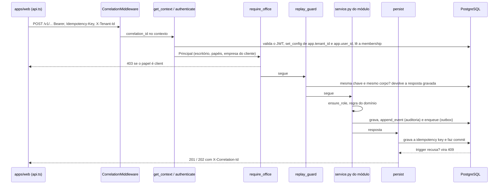
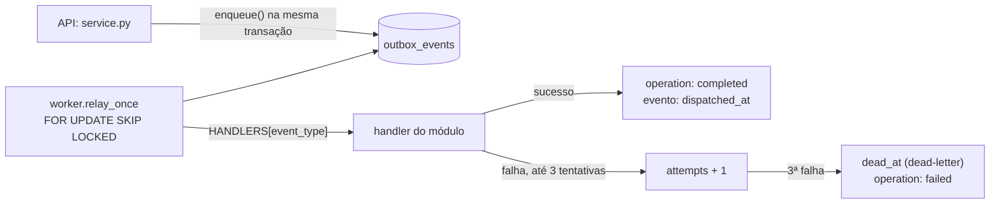
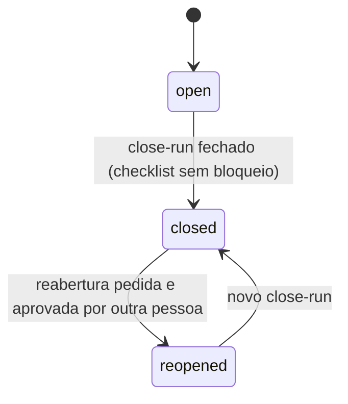
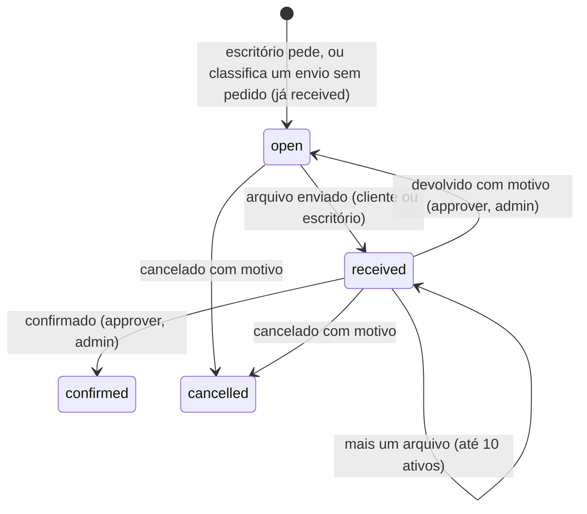
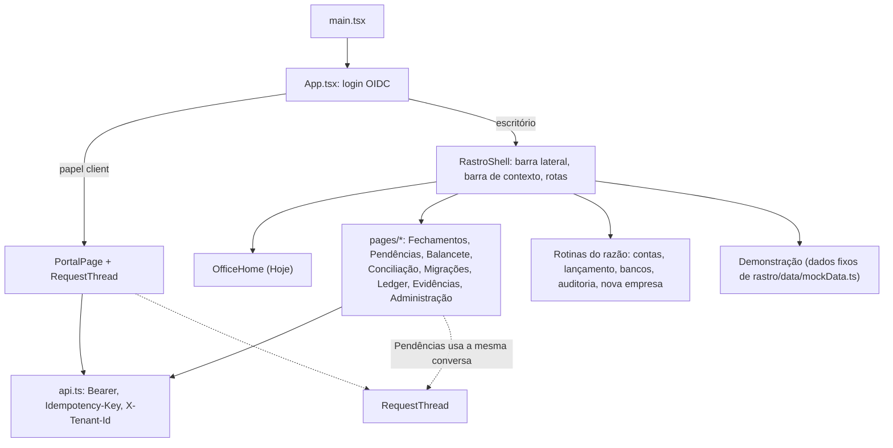

# Mapa do código

Este mapa liga o desenho de [arquitetura](architecture.md) e o [modelo de domínio](domain-model.md) aos arquivos que os implementam. Ele responde onde fica cada regra, por onde passa uma requisição e em que estado cada objeto pode estar. A regra de negócio continua nas ADRs; aqui só se aponta onde ela vive.

## Os dois serviços

| Serviço | Entrada | O que faz |
| --- | --- | --- |
| `apps/api` | [main.py](../apps/api/src/contabil/main.py) | FastAPI. Registra os routers em `/v1`, os tratadores de erro e o middleware de correlation ID. Com `OUTBOX_IN_PROCESS=1`, sobe o worker numa thread do mesmo processo, como no piloto. |
| worker | [worker.py](../apps/api/src/contabil/worker.py) | Lê o outbox, chama o handler do evento, conclui ou falha a operação, verifica a cadeia de auditoria a cada 30 s e varre lembretes de prazo a cada hora. |
| `apps/web` | [App.tsx](../apps/web/src/App.tsx) | Login OIDC. Para papel `client`, abre o [portal](../apps/web/src/pages/PortalPage.tsx); para o escritório, abre a casca [RastroShell](../apps/web/src/rastro/RastroShell.tsx). |

## Módulos da API

Cada módulo fica em `apps/api/src/contabil/<módulo>/`, com `router.py` (HTTP) e `service.py` (regra). As tabelas estão todas em [tables.py](../apps/api/src/contabil/tables.py); as migrações, em [alembic/versions](../apps/api/alembic/versions).

| Módulo | Rotas em `/v1` | Tabelas | Tela | ADR |
| --- | --- | --- | --- | --- |
| `tenancy` | `/me`, `/users`, `/legal-entities` | `tenants`, `app_users`, `memberships`, `legal_entities`, `establishments` | Administração; Rotinas › Nova empresa | [005](adr/005-isolamento-de-tenant.md), [017](adr/017-cadastro-de-empresa.md), [019](adr/019-convite-de-usuario.md), [022](adr/022-troca-de-escritorio.md) |
| `identity` | sem rota própria | `notification_log`; `memberships.notify_client` | Portal (preferência de aviso) | [019](adr/019-convite-de-usuario.md), [028](adr/028-aviso-por-email.md) |
| `master_data` | `/legal-entities/{id}/accounts` | `charts_of_accounts`, `accounts`, `cost_centers` | Rotinas › Plano de contas | [017](adr/017-cadastro-de-empresa.md) |
| `ledger` | `/journals`, `/accounts/{id}/lines`, `/legal-entities/{id}/trial-balance` | `journal_entries`, `journal_lines` | Dados e ledger; Balancete; Novo lançamento | [001](adr/001-ledger-immutavel.md), [004](adr/004-aprovacao-humana.md), [010](adr/010-rls-e-triggers.md) |
| `periods` | `/legal-entities/{id}/periods`, `/periods`, `/reopen-requests` | `accounting_periods`, `reopen_requests` | Fechamentos | [020](adr/020-fechamento-com-evidencia.md) |
| `closing` | `/periods/{id}/close-runs`, `/close-runs` | `close_runs`, `close_run_decisions`, `close_snapshots` | Fechamentos › checklist | [020](adr/020-fechamento-com-evidencia.md) |
| `imports` | `/import-batches`, `/operations` | `import_batches`, `import_batch_files`, `import_rows`, `external_refs`, `import_batch_journals`, `import_reports`, `operations` | Migrações | [012](adr/012-jobs-outbox.md) |
| `reconciliation` | `/bank-accounts`, `/bank-statements`, `/reconciliation-cases` | `bank_accounts`, `bank_statements`, `bank_transactions`, `reconciliation_cases`, `reconciliation_matches` | Conciliação; Rotinas › Bancos | [013](adr/013-conciliacao-por-casos.md) |
| `documents` | `/documents` | `source_documents` | Evidências | [011](adr/011-object-storage-s3.md) |
| `document_requests` | `/document-requests` (inclui fila, comentários e devolução) | `document_requests`, `document_request_files`, `document_request_comments` | Pendências; Hoje | [021](adr/021-pedido-de-documento.md), [024](adr/024-fila-de-pendencias.md), [026](adr/026-devolucao-e-conversa.md) |
| `submissions` | `/client-submissions` | `client_submissions` | Pendências (envios sem pedido) | [027](adr/027-envio-sem-pedido.md) |
| `exports` | `/legal-entities/{id}/exports`, `/exports` | `operational_exports` | Evidências | [023](adr/023-exportacao-operacional.md) |
| `portal` | `/portal/...` | usa as de `document_requests`, `submissions` e `identity` | Portal do cliente | [025](adr/025-portal-do-cliente.md) |
| `audit` | `/audit-events`, `/audit-events/verify` | `audit_events` | Rotinas › Auditoria | [010](adr/010-rls-e-triggers.md) |
| `platform` | `/healthz`, `/readyz` | `idempotency_keys`, `outbox_events` | — | [006](adr/006-adaptadores-e-idempotencia.md), [008](adr/008-outbox-postgresql.md) |

Fora dos módulos: [bootstrap.py](../apps/api/src/contabil/bootstrap.py) cria o escritório e o primeiro admin; [pilot_samples.py](../apps/api/src/contabil/pilot_samples.py) carrega as empresas fictícias do piloto; [pilot_report.py](../apps/api/src/contabil/pilot_report.py) mostra o ciclo dos pedidos; [seed/](../apps/api/src/contabil/seed) é o seed local; [migrate.py](../apps/api/src/contabil/migrate.py) roda o Alembic no release.

## Caminho de uma escrita

Um `POST` do escritório passa pelas mesmas camadas, em ordem. Cada camada tem uma responsabilidade só.



- **Autenticação e escritório:** [platform/auth.py](../apps/api/src/contabil/platform/auth.py). O escritório vem da claim `custom:tenant_id`; `X-Tenant-Id` só troca de escritório para o admin geral, e nunca para o cliente.
- **Papéis:** [platform/principal.py](../apps/api/src/contabil/platform/principal.py), com `ensure_role`, `ensure_office` e `ensure_client`.
- **Idempotência:** [platform/idempotency.py](../apps/api/src/contabil/platform/idempotency.py). `persist` também traduz as constraints únicas em 409 com mensagem legível.
- **Rotas do cliente** não passam por `require_office`: ficam em [portal/router.py](../apps/api/src/contabil/portal/router.py) e chamam `ensure_client`, que prende a leitura à empresa da membership.

## Trabalho assíncrono

Operações longas gravam uma linha em `operations` e um evento em `outbox_events` na mesma transação. A resposta é `202` com `operation_id` e `correlation_id`.



| Evento | Handler | Origem |
| --- | --- | --- |
| `ImportBatchReceived` | `imports.service.validate_batch` | envio de lote |
| `ImportBatchPublishRequested` | `imports.service.publish_batch` | publicação de lote |
| `BankStatementReceived` | `reconciliation.service.import_statement` | envio de extrato |
| `JournalPublished` | `reconciliation.service.resolve_case_from_journal` | publicação de lançamento criado a partir de um caso |
| `OperationalExportRequested` | `exports.service.run_operational_export` | pedido de exportação |
| `DocumentRequestCreated`, `DocumentRequestReturned` | `identity.notices.deliver_notice` | pedido novo e devolução; o lembrete de prazo sai de `sweep_reminders` |

O worker usa a sessão admin e chama `apply_tenant` antes de cada handler. `outbox_events` é a única tabela de negócio sem `FORCE ROW LEVEL SECURITY`, porque o relay lê todos os escritórios ([0004_force_rls.py](../apps/api/alembic/versions/0004_force_rls.py)).

## Estados

Os nomes abaixo são os gravados no banco. A tela traduz para o vocabulário da [SPEC do Rastro](rastro/SPEC.md).

### Lançamento (`journal_entries.status`)

```mermaid
stateDiagram-v2
    [*] --> draft: create_journal (preparer, admin)
    draft --> pending_approval: submit
    pending_approval --> approved: approve (outra pessoa)
    pending_approval --> rejected: reject (com motivo)
    approved --> published: publish (outra pessoa; exige equilíbrio)
    published --> reversed: estorno vinculado publicado
```



Quem cria não aprova nem publica (`_ensure_not_creator`). O estorno nasce como outro lançamento em `draft`, com `reverses_journal_id`. O trigger `guard_journal_entry` só deixa um lançamento publicado mudar para `reversed`; linhas de lançamento publicado não mudam.

### Período e fechamento



Só `open` e `reopened` aceitam lançamento (`POSTING_PERIOD_STATUSES`, em [constants.py](../apps/api/src/contabil/platform/constants.py)). O close-run vai de `open` a `closed` e, numa reabertura, a `reopened`. O snapshot (`close_snapshots`) é gravado uma vez, com SHA-256, e um trigger impede alteração. O checklist e a sua versão estão em [closing/checklist.py](../apps/api/src/contabil/closing/checklist.py).

### Pedido de documento (`document_requests.status`)



`open` e `received` bloqueiam o fechamento. As transições estão em `TRANSITIONS`, em [document_requests/service.py](../apps/api/src/contabil/document_requests/service.py). O cliente envia e comenta; não confirma, não devolve e não cancela.

### Outros objetos

| Objeto | Estados | Onde |
| --- | --- | --- |
| Caso de conciliação | `open`, `suggested`, `approved`, `rejected`, `ignored`, `reversed`. `open`, `suggested` e `reversed` contam como pendentes no checklist. | `reconciliation/service.py` |
| Lote de importação | `received`, `validating`, `ready` ou `failed`, depois `published` ou `partially_published`. Linha: `invalid`, `already_imported`. | `imports/service.py` |
| Extrato | `received`, `parsed` ou `failed` | `reconciliation/service.py` |
| Operação | `accepted`, `running`, `completed`, `failed` | `imports/service.py`, `worker.py` |
| Envio sem pedido | `new`, `classified`, `discarded` | `submissions/service.py` |
| Pedido de reabertura | `pending`, `approved` | `periods/service.py` |

## Onde cada invariante é garantida

Várias regras têm duas barreiras: o serviço recusa com mensagem clara, e o banco recusa mesmo que o serviço falhe.

| Invariante | Serviço | Banco |
| --- | --- | --- |
| Partidas dobradas | `_ensure_balanced` em `ledger/service.py` | constraint trigger `assert_journal_balanced`, adiado para o commit ([0001](../apps/api/alembic/versions/0001_phase_a.py)) |
| Publicado não muda | estados em `ledger/service.py` | triggers `guard_journal_entry` e `guard_journal_line` |
| Auditoria só cresce | `append_event` encadeia o hash ([audit/hash.py](../apps/api/src/contabil/audit/hash.py)) | trigger `audit_append_only` |
| Original do documento | hash SHA-256 em `documents/service.py` | trigger `guard_source_document`; o app só pode alterar classificação, versões derivadas e campos de retenção ([0002](../apps/api/alembic/versions/0002_phase_b.py)) |
| Snapshot do fechamento | gravado uma vez em `closing/service.py` | trigger `guard_close_snapshot` ([0007](../apps/api/alembic/versions/0007_close_runs.py)) |
| Isolamento de escritório | `apply_tenant` em toda sessão | política `tenant_isolation` e `FORCE ROW LEVEL SECURITY` |
| Cliente preso à empresa | `ensure_client` e `principal.legal_entity_id` | membership `client` exige `legal_entity_id` ([0010](../apps/api/alembic/versions/0010_exports_and_client_scope.py)) |
| Segregação de funções | `_ensure_not_creator` no lançamento; o mesmo princípio na publicação de lote e na aprovação de reabertura. Confirmar pedido e aprovar conciliação dependem só do papel. | — |
| Dinheiro em decimal | [platform/money.py](../apps/api/src/contabil/platform/money.py) | `numeric(20, 6)` |

## Interface



- A empresa e a competência escolhidas ficam no [session.tsx](../apps/web/src/session.tsx) e no `sessionStorage`; as telas leem dali e não repetem o seletor.
- Revisões de IA, Obrigações e Integrações usam `PlannedPage`: dizem que não há contrato e não simulam estado.
- A Demonstração não chama a API.

## Como acrescentar um módulo

1. Crie `apps/api/src/contabil/<módulo>/` com `router.py` e `service.py`. No serviço, comece cada operação com `ensure_role`.
2. Registre o router em [main.py](../apps/api/src/contabil/main.py) com `dependencies=office`. Rota do cliente vai em `portal/`.
3. Escrita usa `Depends(replay_guard)` e termina em `persist(...)`; cada mudança de estado chama `append_event`.
4. Trabalho longo cria `Operation`, chama `enqueue` e entra em `HANDLERS`, no [worker.py](../apps/api/src/contabil/worker.py).
5. A migração cria a tabela com `tenant_id`, a política `tenant_isolation`, `FORCE ROW LEVEL SECURITY` e o grant para `contabil_app`. Copie o padrão da [0008](../apps/api/alembic/versions/0008_document_requests.py).
6. Atualize schema, exemplo, OpenAPI, ADR, SPEC e as outras peças da Definition of Done do [AGENTS.md](../AGENTS.md).

## Armadilhas conhecidas

- **`set_config(..., true)` vale só até o commit.** Depois de `session.commit()`, chame `apply_tenant` de novo, senão a RLS devolve vazio.
- **Sessão admin também obedece à RLS.** Com `FORCE`, nem o dono da tabela vê linha sem `apply_tenant`. Script de suporte que lista "nada" quase sempre esqueceu o tenant.
- **`bootstrap()` abre outra sessão.** O que ainda não foi commitado na sessão chamadora não é visível para ele.
- **O nome de usuário é gravado em minúsculas.** O Cognito do piloto não diferencia maiúsculas e devolve `cognito:username` em minúsculas ([ADR 019](adr/019-convite-de-usuario.md)).
- **"Hoje" é a data de Brasília.** O servidor roda em UTC; entre 21h e meia-noite, `date.today()` já é o dia seguinte. Prazo, lembrete e resumo do portal usam `platform.clock.brasilia_today()`.
- **O contrato do pedido não traz os arquivos.** `files` só aparece no detalhe (`GET /v1/document-requests/{request_id}` e `GET /v1/portal/document-requests/{request_id}`). Criar, listar, confirmar, devolver e cancelar devolvem o pedido sem a lista.
- **Aviso sem SES configurado falha calado.** O pedido segue e o log diz `notice skipped`. Antes de uma rodada, confira `MAIL_FROM` e as chaves na API.
- **O Heroku guarda só as últimas 1500 linhas de log.** Para investigar um erro, peça a ação de novo com `heroku logs --tail` aberto. O `X-Correlation-Id` da resposta liga a tela à linha do log.
- **`heroku run` no Windows quebra comando de várias linhas.** Mande o script pela entrada padrão: `heroku run --no-tty --app NOME -- python - < script.py`.
- **No OpenAPI, descrição com vírgula dentro de `{ ... }` vai entre aspas.**

## Mapa gerado

O plugin cartographer gera o grafo de dependências, o traçado de cada endpoint e os diagramas a partir do código, sem gravar no repositório:

```bash
bash ~/.claude/plugins/cache/anthropic-plugin-directory/cartographer/<versão>/run_pipeline.sh . --readonly
```

A saída fica em `~/.cartographer/<hash>/`. O `endpoints.md` e a pasta `endpoints/` mostram, por rota, as funções e os arquivos tocados. O grafo automático liga alguns arquivos por engano, como testes a `rastro/data/types.ts`; use este mapa como referência e o gerado como apoio.
