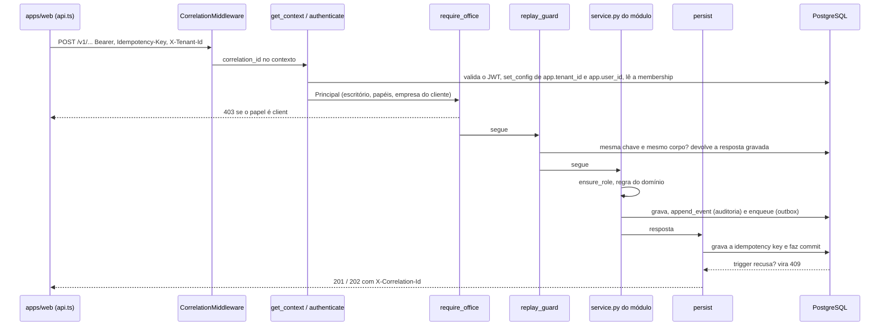
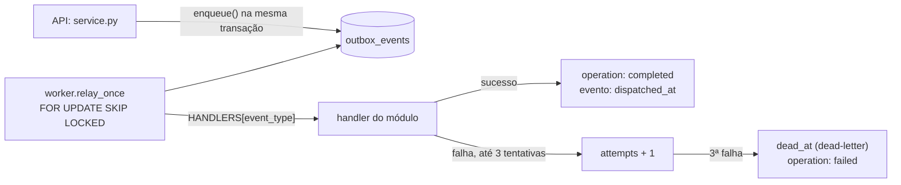
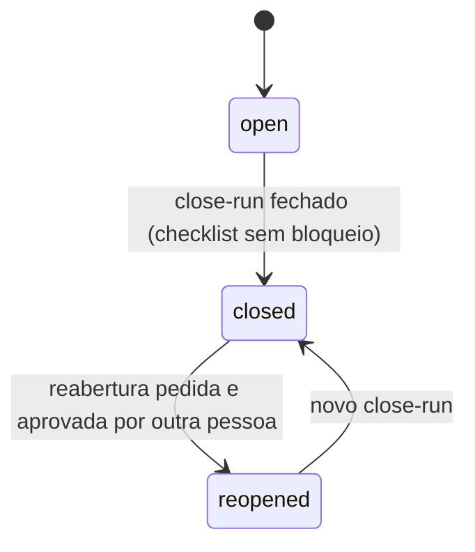
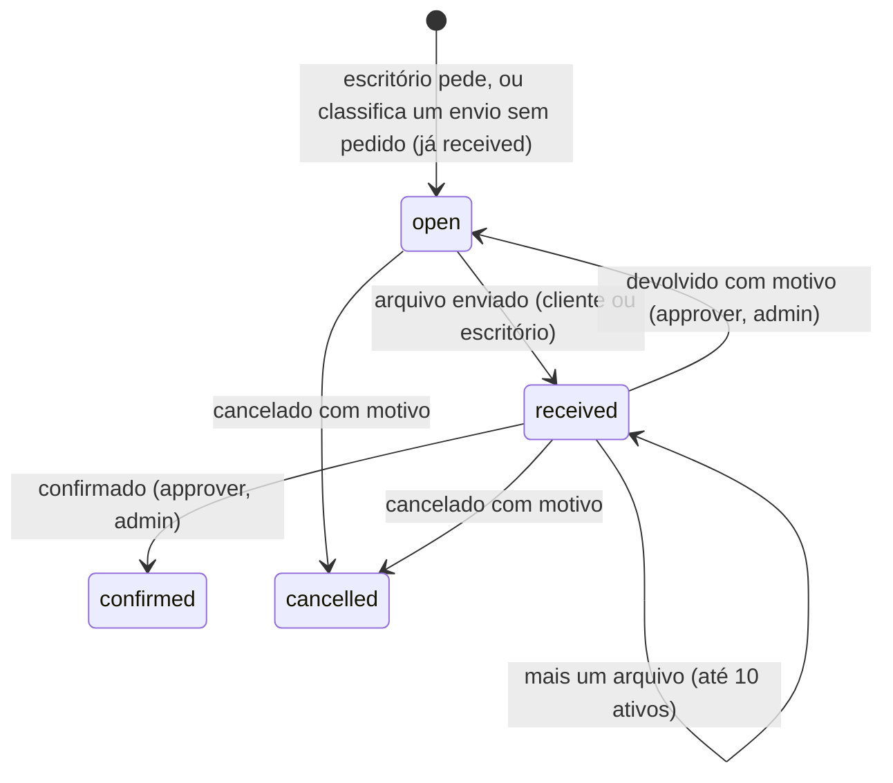
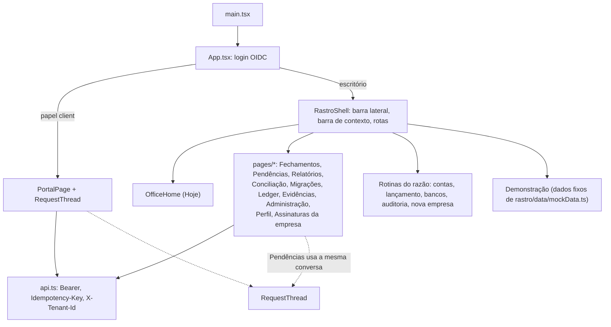

# Mapa do código

Este mapa liga o desenho de [arquitetura](architecture.md) e o [modelo de domínio](domain-model.md) aos arquivos que os implementam. Ele responde onde fica cada regra, por onde passa uma requisição e em que estado cada objeto pode estar. A regra de negócio continua nas ADRs; aqui só se aponta onde ela vive.

## Os dois serviços

| Serviço | Entrada | O que faz |
| --- | --- | --- |
| `apps/api` | [main.py](../apps/api/src/contabil/main.py) | FastAPI. Registra os routers em `/v1`, os tratadores de erro e o middleware de correlation ID. Com `OUTBOX_IN_PROCESS=1`, sobe o worker numa thread do mesmo processo, como no piloto. |
| worker | [worker.py](../apps/api/src/contabil/worker.py) | Lê o outbox, chama o handler do evento, conclui ou falha a operação, verifica a cadeia de auditoria a cada 30 s e varre lembretes de prazo a cada hora. |
| `apps/web` | [App.tsx](../apps/web/src/App.tsx) | Login OIDC. Para papel `client`, abre o [portal](../apps/web/src/pages/PortalPage.tsx); para o escritório, abre a casca [RastroShell](../apps/web/src/rastro/RastroShell.tsx). |

## Módulos da API

Cada módulo fica em `apps/api/src/contabil/<módulo>/`, com `router.py` (HTTP) e `service.py` (regra). As tabelas estão todas em [tables.py](../apps/api/src/contabil/tables.py); as migrações, em [alembic/versions](../apps/api/alembic/versions).

| Módulo | Rotas em `/v1` | Tabelas | Tela | ADR |
| --- | --- | --- | --- | --- |
| `tenancy` | `/me`, `/users`, `/legal-entities` | `tenants`, `app_users`, `memberships`, `legal_entities`, `establishments` | Administração; Rotinas › Nova empresa | [005](adr/005-isolamento-de-tenant.md), [017](adr/017-cadastro-de-empresa.md), [019](adr/019-convite-de-usuario.md), [022](adr/022-troca-de-escritorio.md) |
| `identity` | sem rota própria | `notification_log`; `memberships.notify_client` | Portal (preferência de aviso) | [019](adr/019-convite-de-usuario.md), [028](adr/028-aviso-por-email.md) |
| `master_data` | `/legal-entities/{id}/accounts` | `charts_of_accounts`, `accounts`, `cost_centers` | Rotinas › Plano de contas | [017](adr/017-cadastro-de-empresa.md) |
| `ledger` | `/journals`, `/accounts/{id}/lines` e `.csv`, `/legal-entities/{id}/trial-balance`, `/income-statement` e `/balance-sheet`, cada um com `.csv` (formato em `ledger/csv_export.py`, DRE e Balanço em `ledger/statements.py`), `POST /legal-entities/{id}/year-end-closing` (`ledger/year_end.py`) | `journal_entries`, `journal_lines` | Dados e ledger; Relatórios (balancete, razão, DRE, Balanço, encerramento); Novo lançamento | [001](adr/001-ledger-immutavel.md), [004](adr/004-aprovacao-humana.md), [010](adr/010-rls-e-triggers.md), [029](adr/029-encerramento-e-demonstracoes.md) |
| `periods` | `/legal-entities/{id}/periods`, `/periods`, `/reopen-requests` | `accounting_periods`, `reopen_requests` | Fechamentos | [020](adr/020-fechamento-com-evidencia.md) |
| `closing` | `/periods/{id}/close-runs`, `/close-runs`, `/periods/{id}/trial-balance-checks` (conferências do balancete em `closing/checks.py`, calculadas na leitura) | `close_runs`, `close_run_decisions`, `close_snapshots` | Fechamentos › checklist; Relatórios › balancete (Pontos de atenção) | [020](adr/020-fechamento-com-evidencia.md) |
| `client_summaries` | `/periods/{id}/client-summary` (POST gera ou recalcula, GET), `.../publish` e `.../withdraw`. As frases saem de `compose.py`, função pura sem IA; `withdraw_on_reopen` é chamado por `closing.reopen_closed_run` na mesma transação | `client_summaries` | Fechamentos › Resumo para o cliente; Portal › Resumo do mês | [034](adr/034-resumo-do-mes-para-o-cliente.md) |
| `imports` | `/import-batches`, `/operations` | `import_batches`, `import_batch_files`, `import_rows`, `external_refs`, `import_batch_journals`, `import_reports`, `operations` | Migrações | [012](adr/012-jobs-outbox.md) |
| `reconciliation` | `/bank-accounts`, `/bank-statements`, `/reconciliation-cases`. Os alertas do extrato (`alerts`, `alert_count`) saem de `reconciliation/alerts.py`, com limiares de `configs/conferencias.yaml` lidos por `platform/conferences.py` | `bank_accounts`, `bank_statements`, `bank_transactions`, `reconciliation_cases`, `reconciliation_matches` | Conciliação; Rotinas › Bancos | [013](adr/013-conciliacao-por-casos.md) |
| `suggestions` | `POST /bank-accounts/{id}/counterpart-suggestions`. `history.py` sugere pelo histórico da empresa (na leitura do caso); `pseudonymize.py` mascara a descrição; `model.py` monta o prompt, chama o SDK `anthropic` e valida a resposta; `worker.py` roda um lote por despacho e enfileira a continuação; `smoke.py` é a chamada real manual, só com autorização do gasto | `account_suggestions`, `suggestion_runs` (só INSERT e SELECT) | Conciliação (sugestão pré-selecionada e "Pedir sugestão à IA") | [004](adr/004-aprovacao-humana.md), [035](adr/035-sugestao-de-conta-por-modelo.md) |
| `documents` | `/documents` | `source_documents` | Evidências | [011](adr/011-object-storage-s3.md) |
| `document_requests` | `/document-requests` (inclui fila, comentários e devolução) | `document_requests`, `document_request_files`, `document_request_comments` | Pendências; Hoje | [021](adr/021-pedido-de-documento.md), [024](adr/024-fila-de-pendencias.md), [026](adr/026-devolucao-e-conversa.md) |
| `submissions` | `/client-submissions` | `client_submissions` | Pendências (envios sem pedido) | [027](adr/027-envio-sem-pedido.md) |
| `exports` | `/legal-entities/{id}/exports` (`operational_v1`, `ecd_preview_v1` ou `reinf_r4000_preview_v1`), `/exports/{id}` e `/exports/{id}/file` | `operational_exports` | Evidências; Relatórios › Prévia da ECD e Prévia da EFD-Reinf | [023](adr/023-exportacao-operacional.md), [031](adr/031-registry-minimo-e-previa-ecd.md), [032](adr/032-previa-efd-reinf-r4000.md) |
| `regulatory` | `/legal-entities/{id}/ecd-registration` (GET e PUT, só admin grava) e `/regulatory/reinf/natures`. O leiaute é dado em `regulatory/data/ecd/*.json`; `registry.py` escolhe a versão pela vigência, `writer.py` serializa os registros e `ecd_preview.py` monta a prévia e as conferências. Na EFD-Reinf, os XSDs oficiais ficam sem modificação em `regulatory/data/reinf/v2_01_02/`, a Tabela 01 em `natureza-rendimentos.json`, e `reinf_preview.py` monta e valida os eventos com lxml | `ecd_registrations` | Relatórios › Prévia da ECD e Prévia da EFD-Reinf | [002](adr/002-registry-regulatorio-versionado.md), [031](adr/031-registry-minimo-e-previa-ecd.md), [032](adr/032-previa-efd-reinf-r4000.md) |
| `withholdings` | `/legal-entities/{id}/withholding-payments` (GET; POST e DELETE para preparer, approver e admin). `validators.py` confere documento, natureza, valores e data; a prévia da EFD-Reinf repete a conferência sobre o que está gravado | `withholding_payments` | Relatórios › Prévia da EFD-Reinf | [032](adr/032-previa-efd-reinf-r4000.md) |
| `portal` | `/portal/...`, inclusive `/portal/summaries` e `/portal/summaries/{id}` (só resumo publicado da empresa da membership) | usa as de `document_requests`, `submissions`, `identity` e `client_summaries` | Portal do cliente | [025](adr/025-portal-do-cliente.md), [034](adr/034-resumo-do-mes-para-o-cliente.md) |
| `signatories` | `/me/professional-registration`, `/legal-entities/{id}/signatories` (GET e PUT). A leitura `signatories_for` em `signatories/service.py` alimenta `ledger/statements.py` e o J930 da ECD; a escrita fica em `signatories/editing.py` | `professional_registrations`, `entity_signatories` | Perfil; Administração › Assinaturas; assinaturas da DRE e do Balanço | [030](adr/030-signatarios-das-demonstracoes.md) |
| `audit` | `/audit-events`, `/audit-events/verify` | `audit_events` | Rotinas › Auditoria | [010](adr/010-rls-e-triggers.md) |
| `platform` | `/healthz`, `/readyz` | `idempotency_keys`, `outbox_events` | — | [006](adr/006-adaptadores-e-idempotencia.md), [008](adr/008-outbox-postgresql.md) |

Fora dos módulos: [bootstrap.py](../apps/api/src/contabil/bootstrap.py) cria o escritório e o primeiro admin; [pilot_samples.py](../apps/api/src/contabil/pilot_samples.py) carrega as empresas fictícias do piloto; [pilot_round.py](../apps/api/src/contabil/pilot_round.py) cria o login fictício dos clientes de teste e abre os pedidos da rodada; [pilot_simulation.py](../apps/api/src/contabil/pilot_simulation.py) simula os cinco clientes com roteiro fixo; [pilot_report.py](../apps/api/src/contabil/pilot_report.py) mostra o ciclo dos pedidos; [seed/](../apps/api/src/contabil/seed) é o seed local; [migrate.py](../apps/api/src/contabil/migrate.py) roda o Alembic no release.

## Caminho de uma escrita

Um `POST` do escritório passa pelas mesmas camadas, em ordem. Cada camada tem uma responsabilidade só.



- **Autenticação e escritório:** [platform/auth.py](../apps/api/src/contabil/platform/auth.py). O escritório vem da claim `custom:tenant_id`; `X-Tenant-Id` só troca de escritório para o admin geral, e nunca para o cliente.
- **Papéis:** [platform/principal.py](../apps/api/src/contabil/platform/principal.py), com `ensure_role`, `ensure_office` e `ensure_client`.
- **Idempotência:** [platform/idempotency.py](../apps/api/src/contabil/platform/idempotency.py). `persist` também traduz as constraints únicas em 409 com mensagem legível.
- **Rotas do cliente** não passam por `require_office`: ficam em [portal/router.py](../apps/api/src/contabil/portal/router.py) e chamam `ensure_client`, que prende a leitura à empresa da membership.

## Trabalho assíncrono

Operações longas gravam uma linha em `operations` e um evento em `outbox_events` na mesma transação. A resposta é `202` com `operation_id` e `correlation_id`.



| Evento | Handler | Origem |
| --- | --- | --- |
| `ImportBatchReceived` | `imports.service.validate_batch` | envio de lote |
| `ImportBatchPublishRequested` | `imports.service.publish_batch` | publicação de lote |
| `BankStatementReceived` | `reconciliation.service.import_statement` | envio de extrato |
| `JournalPublished` | `reconciliation.service.resolve_case_from_journal` | publicação de lançamento criado a partir de um caso |
| `OperationalExportRequested` | `exports.service.run_operational_export` | pedido de exportação |
| `EcdPreviewRequested` | `exports.service.run_ecd_preview` | pedido da prévia da ECD (`kind: ecd_preview_v1`); guarda o .txt no storage como documento `generated` |
| `ReinfPreviewRequested` | `exports.service.run_reinf_preview` | pedido da prévia da EFD-Reinf R-4000 (`kind: reinf_r4000_preview_v1`); guarda o .zip no storage como documento `generated` |
| `DocumentRequestCreated`, `DocumentRequestReturned` | `identity.notices.deliver_notice` | pedido novo e devolução; o lembrete de prazo sai de `sweep_reminders` |
| `CounterpartSuggestionRequested` | `suggestions.worker.run_counterpart_suggestions` | pedido de sugestão por IA (`kind: counterpart_suggestions`). Um lote de até 40 transações por despacho; se restarem casos e couber no teto, enfileira outro `CounterpartSuggestionRequested` com o mesmo `operation_id` e um `cursor`, e devolve `HandlerOutcome.CONTINUES` para a operação seguir `running`; antes de cada chamada grava a reserva em `suggestion_runs` numa transação própria (`_autonomous`), depois o resultado e as `account_suggestions`. Teto atingido ou resposta incompleta concluem a operação com `error_code` `limite_diario` ou `resposta_incompleta` |

O worker usa a sessão admin e chama `apply_tenant` antes de cada handler. Cada ciclo (`run_cycle`) roda o relay, os lembretes e a verificação da cadeia de auditoria em sessões separadas: a falha de uma tarefa não desfaz o commit das outras. `outbox_events` é a única tabela de negócio sem `FORCE ROW LEVEL SECURITY`, porque o relay lê todos os escritórios ([0004_force_rls.py](../apps/api/alembic/versions/0004_force_rls.py)).

## Estados

Os nomes abaixo são os gravados no banco. A tela traduz para o vocabulário da [SPEC do Rastro](rastro/SPEC.md).

### Lançamento (`journal_entries.status`)

```mermaid
stateDiagram-v2
    [*] --> draft: create_journal (preparer, admin)
    draft --> pending_approval: submit
    pending_approval --> approved: approve (outra pessoa)
    pending_approval --> rejected: reject (com motivo)
    approved --> published: publish (outra pessoa; exige equilíbrio)
    published --> reversed: estorno vinculado publicado
```



Quem cria não aprova nem publica (`_ensure_not_creator`). O estorno nasce como outro lançamento em `draft`, com `reverses_journal_id`. O trigger `guard_journal_entry` só deixa um lançamento publicado mudar para `reversed`; linhas de lançamento publicado não mudam.

### Período e fechamento



Só `open` e `reopened` aceitam lançamento (`POSTING_PERIOD_STATUSES`, em [constants.py](../apps/api/src/contabil/platform/constants.py)). O close-run vai de `open` a `closed` e, numa reabertura, a `reopened`. O snapshot (`close_snapshots`) é gravado uma vez, com SHA-256, e um trigger impede alteração. O checklist e a sua versão estão em [closing/checklist.py](../apps/api/src/contabil/closing/checklist.py).

### Pedido de documento (`document_requests.status`)



`open` e `received` bloqueiam o fechamento. As transições estão em `TRANSITIONS`, em [document_requests/service.py](../apps/api/src/contabil/document_requests/service.py). O cliente envia e comenta; não confirma, não devolve e não cancela.

### Resumo do mês (`client_summaries.status`)

```mermaid
stateDiagram-v2
    [*] --> draft: gerar (preparer, approver, admin; competência fechada)
    draft --> draft: recalcular
    draft --> published: publicar (approver, admin; não quem gerou)
    published --> withdrawn: retirar com motivo (approver, admin)
    draft --> withdrawn: reabertura da competência
    published --> withdrawn: reabertura ("Competência reaberta")
```



Há no máximo um resumo não retirado por competência (`uq_client_summaries_period`). O trigger `guard_client_summary` ([0022](../apps/api/alembic/versions/0022_client_summaries.py)) recusa DELETE, mudar `payload` fora de `draft`, mudar escritório, empresa ou período, voltar de `published` para `draft` e sair de `withdrawn`. O GET do escritório devolve o vivo ou, sem ele, o retirado mais recente; o portal só vê `published`.

### Outros objetos

| Objeto | Estados | Onde |
| --- | --- | --- |
| Caso de conciliação | `open`, `suggested`, `approved`, `rejected`, `ignored`, `reversed`. `open`, `suggested` e `reversed` contam como pendentes no checklist. | `reconciliation/service.py` |
| Lote de importação | `received`, `validating`, `ready` ou `failed`, depois `published` ou `partially_published`. Linha: `invalid`, `already_imported`. | `imports/service.py` |
| Extrato | `received`, `parsed` ou `failed` | `reconciliation/service.py` |
| Operação | `accepted`, `running`, `completed`, `failed` | `imports/service.py`, `worker.py` |
| Envio sem pedido | `new`, `classified`, `discarded` | `submissions/service.py` |
| Pedido de reabertura | `pending`, `approved` | `periods/service.py` |
| Pagamento com retenção | sem estado: existe ou foi excluído. Só entra e sai com a competência aberta (`require_period(..., for_posting=True)`). | `withholdings/service.py` |

## Onde cada invariante é garantida

Várias regras têm duas barreiras: o serviço recusa com mensagem clara, e o banco recusa mesmo que o serviço falhe.

| Invariante | Serviço | Banco |
| --- | --- | --- |
| Partidas dobradas | `_ensure_balanced` em `ledger/service.py` | constraint trigger `assert_journal_balanced`, adiado para o commit ([0001](../apps/api/alembic/versions/0001_phase_a.py)) |
| Publicado não muda | estados em `ledger/service.py` | triggers `guard_journal_entry` e `guard_journal_line`; a linha não troca de journal ([0021](../apps/api/alembic/versions/0021_journal_line_guards.py)) |
| Livro e trilha sem TRUNCATE | — | trigger `block_truncate` em `audit_events`, `journal_entries` e `journal_lines` ([0021](../apps/api/alembic/versions/0021_journal_line_guards.py)) |
| Origem do lançamento | `PUBLIC_SOURCES` em `ledger/service.py`: a rota aceita `manual` e `adjustment`; o módulo de origem passa `system_source=True` | — |
| Importação e documento por empresa | `_external` em `imports/service.py` e `_find_hash` em `documents/service.py` filtram pela empresa | `uq_external_refs` com `legal_entity_id` ([0019](../apps/api/alembic/versions/0019_external_refs_entity.py)); índices `uq_documents_entity_sha` e `uq_documents_office_sha` ([0020](../apps/api/alembic/versions/0020_documents_entity_sha.py)) |
| Nome de usuário de um só escritório | `invite_user` em `tenancy/service.py` recusa nome que já existe em `app_users` sem vínculo no escritório | chave primária de `app_users` |
| Auditoria só cresce | `append_event` encadeia o hash ([audit/hash.py](../apps/api/src/contabil/audit/hash.py)) | trigger `audit_append_only` |
| Original do documento | hash SHA-256 em `documents/service.py` | trigger `guard_source_document`; o app só pode alterar classificação, versões derivadas e campos de retenção ([0002](../apps/api/alembic/versions/0002_phase_b.py)) |
| Snapshot do fechamento | gravado uma vez em `closing/service.py` | trigger `guard_close_snapshot` ([0007](../apps/api/alembic/versions/0007_close_runs.py)) |
| Resumo publicado não muda | estados e quatro olhos em `client_summaries/service.py` | trigger `guard_client_summary` e índice `uq_client_summaries_period` ([0022](../apps/api/alembic/versions/0022_client_summaries.py)) |
| Sugestão e custo só crescem | `suggestions/worker.py` só insere | grant só `SELECT, INSERT` em `account_suggestions` e `suggestion_runs` ([0023](../apps/api/alembic/versions/0023_account_suggestions.py)) |
| Sugestão não cruza empresa | `validate_picks` em `suggestions/model.py` descarta conta de outra empresa, inexistente, inativa ou não lançável e ref não enviado; `counterpart_suggestions` filtra por `legal_entity_id` | — |
| Isolamento de escritório | `apply_tenant` em toda sessão | política `tenant_isolation` e `FORCE ROW LEVEL SECURITY` |
| Cliente preso à empresa | `ensure_client` e `principal.legal_entity_id` | membership `client` exige `legal_entity_id` ([0010](../apps/api/alembic/versions/0010_exports_and_client_scope.py)) |
| Segregação de funções | `_ensure_not_creator` no lançamento; o mesmo princípio na publicação de lote e na aprovação de reabertura. Confirmar pedido e aprovar conciliação dependem só do papel. | — |
| Dinheiro em decimal | [platform/money.py](../apps/api/src/contabil/platform/money.py) | `numeric(20, 6)` |
| Pagamento com retenção coerente | `payment_problems` em `withholdings/validators.py` (de novo na prévia) | checks da [0018](../apps/api/alembic/versions/0018_withholding_payments.py): tipo, documento, natureza, bruto > 0, retido ≤ base, sem CSRF em pessoa física |

## Interface



- A empresa e a competência escolhidas ficam no [session.tsx](../apps/web/src/session.tsx) e no `sessionStorage`; as telas leem dali e não repetem o seletor.
- Revisões de IA, Obrigações e Integrações usam `PlannedPage`: dizem que não há contrato e não simulam estado.
- A Demonstração não chama a API.

## Como acrescentar um módulo

1. Crie `apps/api/src/contabil/<módulo>/` com `router.py` e `service.py`. No serviço, comece cada operação com `ensure_role`.
2. Registre o router em [main.py](../apps/api/src/contabil/main.py) com `dependencies=office`. Rota do cliente vai em `portal/`.
3. Escrita usa `Depends(replay_guard)` e termina em `persist(...)`; cada mudança de estado chama `append_event`.
4. Trabalho longo cria `Operation`, chama `enqueue` e entra em `HANDLERS`, no [worker.py](../apps/api/src/contabil/worker.py).
5. A migração cria a tabela com `tenant_id`, a política `tenant_isolation`, `FORCE ROW LEVEL SECURITY` e o grant para `contabil_app`. Copie o padrão da [0008](../apps/api/alembic/versions/0008_document_requests.py).
6. Atualize schema, exemplo, OpenAPI, ADR, SPEC e as outras peças da Definition of Done do [AGENTS.md](../AGENTS.md).

## Armadilhas conhecidas

- **`set_config(..., true)` vale só até o commit.** Depois de `session.commit()`, chame `apply_tenant` de novo, senão a RLS devolve vazio.
- **Sessão admin também obedece à RLS.** Com `FORCE`, nem o dono da tabela vê linha sem `apply_tenant`. Script de suporte que lista "nada" quase sempre esqueceu o tenant.
- **`bootstrap()` abre outra sessão.** O que ainda não foi commitado na sessão chamadora não é visível para ele.
- **O nome de usuário é gravado em minúsculas.** O Cognito do piloto não diferencia maiúsculas e devolve `cognito:username` em minúsculas ([ADR 019](adr/019-convite-de-usuario.md)).
- **"Hoje" é a data de Brasília.** O servidor roda em UTC; entre 21h e meia-noite, `date.today()` já é o dia seguinte. Prazo, lembrete e resumo do portal usam `platform.clock.brasilia_today()`.
- **O contrato do pedido não traz os arquivos.** `files` só aparece no detalhe (`GET /v1/document-requests/{request_id}` e `GET /v1/portal/document-requests/{request_id}`). Criar, listar, confirmar, devolver e cancelar devolvem o pedido sem a lista.
- **Aviso sem SES configurado falha calado.** O pedido segue e o log diz `notice skipped`. Antes de uma rodada, confira `MAIL_FROM` e as chaves na API.
- **O Heroku guarda só as últimas 1500 linhas de log.** Para investigar um erro, peça a ação de novo com `heroku logs --tail` aberto. O `X-Correlation-Id` da resposta liga a tela à linha do log.
- **`heroku run` no Windows quebra comando de várias linhas.** Mande o script pela entrada padrão: `heroku run --no-tty --app NOME -- python - < script.py`.
- **No OpenAPI, descrição com vírgula dentro de `{ ... }` vai entre aspas.**
- **`TRUNCATE` do livro exige `app.allow_truncate`.** A limpeza dos testes (`tests/integration/world.py`) liga `SET LOCAL app.allow_truncate = 'on'` antes do `TRUNCATE`. Script de suporte que precise apagar o livro faz o mesmo, de propósito.
- **`ENVIRONMENT` decide a checagem da configuração.** `development` aceita os padrões de localhost. A imagem do piloto fixa `pilot`; aí a API não sobe com `dev-only`, `localhost`, claim de identidade ausente ou `SEED_DEMO`. O erro de subida diz qual variável.
- **A tela de fechamento não cria execução.** A leitura usa `GET`; a execução nasce no botão "Abrir checklist" (`POST /v1/periods/{period_id}/close-runs`).
- **O CRC é por escritório.** `professional_registrations` tem `tenant_id`; quem troca de escritório não leva o registro. Signatário de empresa sem registro no escritório ativo some da DRE, e `signatories_for` devolve o contador como `None`.
- **A prévia da ECD não é o leiaute no código.** Campo, tamanho, constante e ordem vêm do JSON do registry. Mudar o leiaute é acrescentar um arquivo com outra vigência; o escritor não ganha `if` por campo. O arquivo usa ISO-8859-1 e CR+LF, e o `.gitattributes` mantém o fixture `examples/ecd-preview.example.txt` sem conversão de fim de linha.
- **`ecd_registrations.registry_date` muda de sentido com `registry_kind`.** Na Junta é a data do arquivamento; no cartório, sem NIRE, é a data de abertura. As duas vão para o I030.DT_ARQ. A tela troca o rótulo; a coluna é a mesma. A `conversion_date` (migração 0017) vai para o I030.DT_ARQ_CONV e só vale na Junta: `validate_registration` a recusa no cartório e a zera ao salvar.
- **O CNPJ pode ter letras.** `valid_cnpj` aceita o alfanumérico (IN RFB 2.229/2024) e grava em maiúscula. Código que trata o CNPJ como só dígitos (`formatCnpj`, `cnpj_br`, a busca da barra) deixa o alfanumérico sem máscara ou não o encontra pelos dígitos.
- **CPF não vai para a trilha nem para a demonstração.** A auditoria do perfil guarda só UF e categoria; a DRE e o Balanço levam nome e legenda. O CPF do representante sai mascarado para quem não é admin.
- **Rotas com PUT e DELETE.** O perfil e os signatários usam `PUT`; a exclusão de pagamento com retenção usa `DELETE`. O CORS de `main.py` libera os dois.
- **DELETE idempotente responde 204 sem corpo.** `persist(..., 204, {})` grava a chave e `stored_response` devolve a resposta vazia, também na repetição.
- **Os XSDs da EFD-Reinf não podem ser editados.** São CC BY-ND 3.0 e ficam byte a byte (o `.gitattributes` desliga a conversão de fim de linha). A assinatura obrigatória é atendida na validação por um `<Signature/>` vazio numa cópia em memória e pelo schema auxiliar próprio `xmldsig-marcador-previa.xsd`; o XML do zip sai sem assinatura.
- **O id do evento da EFD-Reinf usa a raiz do CNPJ.** `ID` + `1` + raiz de 8 posições com zeros à direita + data e hora de Brasília + sequência, como o `ideContri/nrInsc` (Anexo II, `REGRA_VALIDA_ID_EVENTO`).

- **A duplicidade do extrato sai por grupo.** `statement_alerts` liga os pares de saída de mesmo valor e histórico parecido dentro da janela e devolve um alerta por grupo ligado (dez tarifas iguais no mesmo dia dão um alerta com dez ids); `own_transfer` continua por par. `alerts_by_transaction` corta em 20 alertas por caso, o `maxItems` do schema.
- **Os alertas do extrato são calculados na leitura.** Não há tabela: `alerts_for_transactions` relê as transações da empresa na janela a cada listagem, detalhe e resposta de mutação do caso, e `period_alert_count` faz o mesmo para o resumo da conta e o checklist. Mudar `configs/conferencias.yaml` muda o resultado de competências passadas; o snapshot do fechamento guarda só a contagem do momento.
- **O histórico da sugestão faz consultas por caso.** `case_dict` chama `counterpart_suggestions` para cada caso que ainda aceita lançamento, e `history_suggestions` lê até 2.000 casos recentes da empresa a cada chamada: `list_cases` vira N+1. Com muitos casos abertos, a listagem fica lenta antes de qualquer outra coisa.
- **O teto diário de sugestão por IA não é atômico.** A rota e o worker conferem `used_today` e depois reservam o lote em transação própria. Duas operações concorrentes do mesmo escritório podem passar do `SUGGESTION_DAILY_LIMIT` em até um lote (40 transações).
- **A sugestão por IA anda um lote por despacho.** A chamada ao modelo roda dentro da transação do relay (`relay_once`) e seguraria os outros eventos por minutos se o handler mandasse todos os lotes. Por isso `run_counterpart_suggestions` processa um lote, enfileira a continuação com o mesmo `operation_id` e um `cursor` (data e id do último caso da janela) e devolve `HandlerOutcome.CONTINUES` (`platform/outbox.py`). O relay só chama `_complete_operation` quando o handler não devolve `CONTINUES`; os outros handlers devolvem `None` e não mudaram. Handler novo que precise de partes usa o mesmo retorno; o que esquecer de enfileirar a continuação deixa a operação `running` para sempre.
- **A reentrega reenvia caso sem sugestão válida.** A janela do despacho (40 casos depois do cursor) é fixada antes de tirar os casos que já têm `account_suggestions` da operação: a reentrega do mesmo despacho não paga de novo os sugeridos e não invade o lote seguinte, mas o caso cujo pick foi descartado volta ao modelo e é pago de novo. A reentrega também enfileira de novo a continuação; uma continuação duplicada cai numa janela já sugerida e não chama o modelo. Um pedido novo reenvia casos que já têm sugestão de operação anterior.
- **Chave inválida gasta o teto.** A reserva entra antes de cada chamada. Com chave inválida, cada uma das 3 tentativas do despacho reserva o lote: até 3 × 40 transações por pedido antes de a operação virar `failed`.
- **`CLAUDE_API_KEY` decide o botão.** Sem a chave, a rota responde 503 e `model_suggestions_enabled` é `false`. O compose repassa a variável à `api` e ao `worker`; os testes de integração nunca chamam a rede e trocam o cliente por um falso.

## Mapa gerado

O plugin cartographer gera o grafo de dependências, o traçado de cada endpoint e os diagramas a partir do código, sem gravar no repositório:

```bash
bash ~/.claude/plugins/cache/anthropic-plugin-directory/cartographer/<versão>/run_pipeline.sh . --readonly
```

A saída fica em `~/.cartographer/<hash>/`. O `endpoints.md` e a pasta `endpoints/` mostram, por rota, as funções e os arquivos tocados. O grafo automático liga alguns arquivos por engano, como testes a `rastro/data/types.ts`; use este mapa como referência e o gerado como apoio.

O [CI](../.github/workflows/ci.yml) roda testes, lint e validadores em todo PR. Um teste de integração pulado faz o job falhar.
